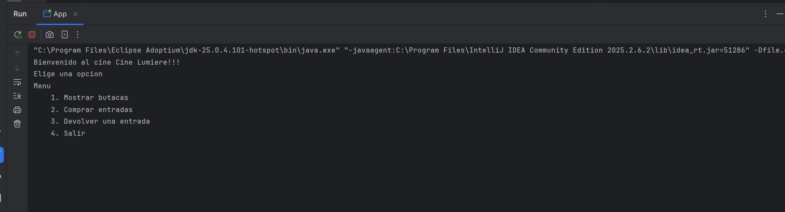
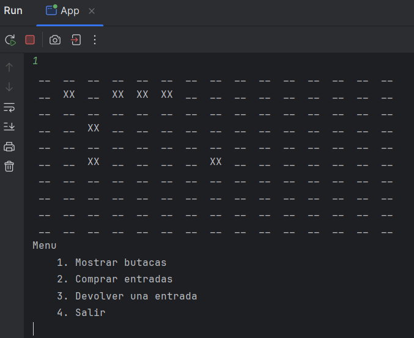
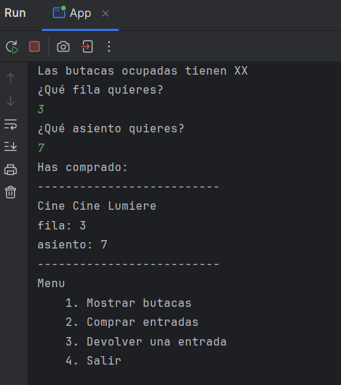

# Cine Lumiere (Java)

Aplicación de consola en Java para gestionar la venta y devolución de entradas de un cine, hecha como práctica de Programación (DAM).

## Funcionalidades
- Mostrar el estado de la sala (10 filas × 15 asientos): `XX` es butaca ocupada y `__` libre.
- Comprar una entrada eligiendo fila y asiento, controlando que no esté ocupado.
- Devolver una entrada.
- Las butacas vendidas se guardan en el fichero `entradasVendidas.txt`, y se conservan al cerrar el programa.

## Tecnologías
Java · Programación orientada a objetos · Ficheros (`java.nio.file`) · Gestión de excepciones

## Estructura
- `App.java`: punto de entrada del programa.
- `GestorCine.java`: menú principal.
- `Cine.java`: sala, butacas y lectura/escritura del fichero.
- `Butaca.java`: representa una butaca (fila y asiento).

## Cómo ejecutarlo
Requisito: JDK 11 o superior.
1. Clona el repositorio.
2. Abre la carpeta del proyecto en un IDE de Java (IntelliJ, VS Code, Eclipse...).
3. Ejecuta `App.java`. El directorio de trabajo debe ser la raíz del proyecto, donde está `entradasVendidas.txt`.

## Capturas

